# MeshAzimuth

<p align="center">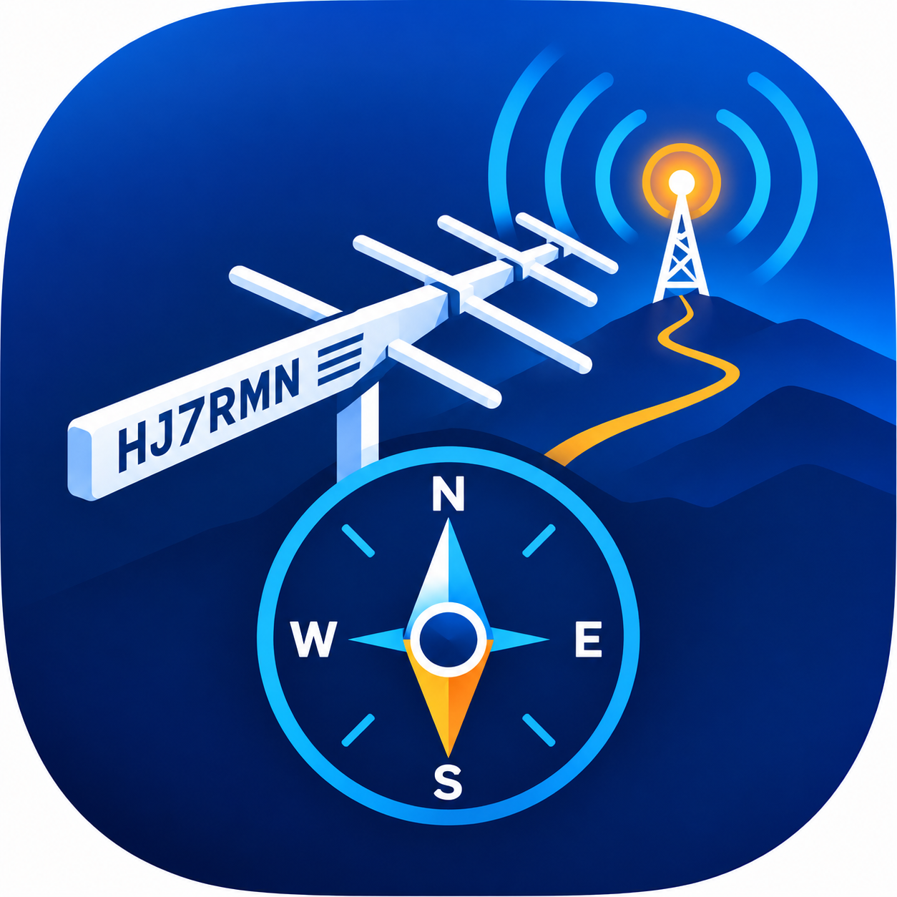</p>

MeshAzimuth es una app iOS (SwiftUI, iOS 17+) para **orientar una antena Yagi-Uda hacia un repetidor MeshCore y comprobar con medidas reales que quedó bien apuntada**.

Hace dos cosas:

1. **Apunta:** calcula el azimut verdadero, la distancia y la elevación hacia el repetidor y te guía con una brújula hasta alinear el boom.
2. **Mide:** con un *pinger LoRa* (un XIAO nRF52840 + Wio-SX1262 que habla con la app por Bluetooth) envía tramas `TRACE` al repetidor y muestra en vivo el SNR de subida, el SNR de bajada, el RSSI y la pérdida. Cada medición queda atada al rumbo del teléfono y se exporta a CSV.

<p align="center">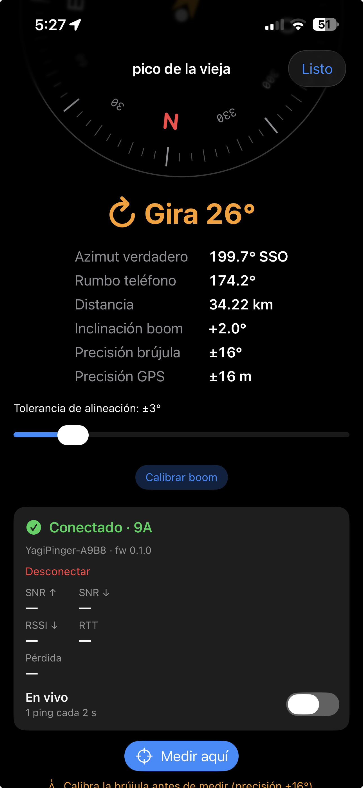</p>

## Qué necesitas

| Qué | Detalle |
|---|---|
| iPhone con iOS 17+ | Magnetómetro y GPS (el simulador no los tiene) |
| Una Yagi y su boom | El teléfono va plano sobre el boom, con el borde superior hacia el director |
| Pinger LoRa | XIAO nRF52840 + Wio-SX1262 con el firmware *pinger* (ver más abajo) y antena de 915 MHz |
| Un repetidor MeshCore | Y el **prefijo hash**: el primer byte de su clave pública (2 dígitos hex) |

<p align="center">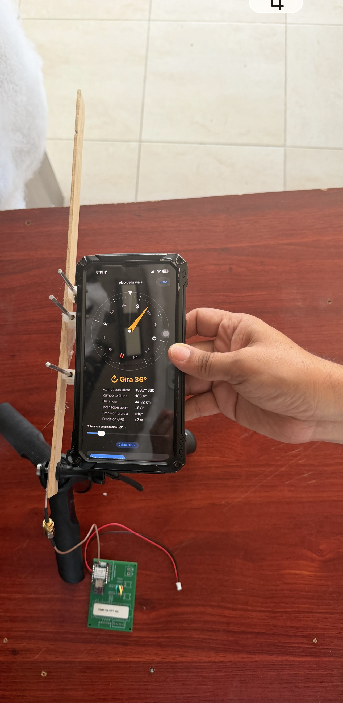</p>

## 1. Firmware del pinger

El pinger es una variante del firmware MeshCore que **solo** transmite una trama `TRACE` directa de 12 bytes hacia el repetidor y mide el eco. No participa en la mesh: no hace flood, no anuncia y respeta un límite de 10 % de tiempo en el aire.

- Código, tests y documentación: [`examples/trace_pinger`](https://github.com/120m4n/MeshCore-HJ7RMN/tree/feature/i2c-actuator-public-channel/examples/trace_pinger) en el repositorio [MeshCore-HJ7RMN](https://github.com/120m4n/MeshCore-HJ7RMN).
- **Cómo flashearlo:** [FLASHING.md](https://github.com/120m4n/MeshCore-HJ7RMN/blob/feature/i2c-actuator-public-channel/examples/trace_pinger/FLASHING.md). En resumen:

```bash
git clone -b feature/i2c-actuator-public-channel https://github.com/120m4n/MeshCore-HJ7RMN
cd MeshCore-HJ7RMN
pio run -e Xiao_nrf52_trace_pinger -t upload
```

Al arrancar, el pinger anuncia por Bluetooth el nombre **`YagiPinger-XXXX`** y habla el protocolo de líneas descrito en la [spec 001](specs/001-trace-pinger-firmware/contracts/line-protocol.md). Por defecto usa el preset de radio de MeshCore Australia (915.8 MHz, BW 250, SF10, CR 5) y **22 dBm sin tope**: el cumplimiento de la normativa de PIRE de tu país y tu antena es responsabilidad tuya.

## 2. Instalar la app

```bash
brew install xcodegen
cd <carpeta-del-repositorio>
xcodegen generate
open MeshAzimuth.xcodeproj
```

Selecciona tu equipo de firma y ejecútala en un iPhone físico. La primera vez iOS pedirá permiso de **ubicación** (azimut) y de **Bluetooth** (pinger).

## 3. Paso a paso

| | |
|---|---|
| 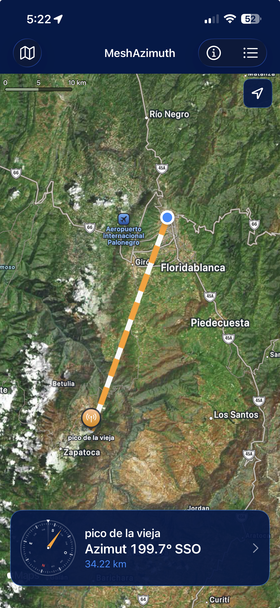 | **1. Marca el repetidor.**<br>Toca el mapa donde está. Se guardan varios, con nombre y altitud opcional. Al seleccionarlo, el panel inferior muestra el **azimut** y la distancia. |
| 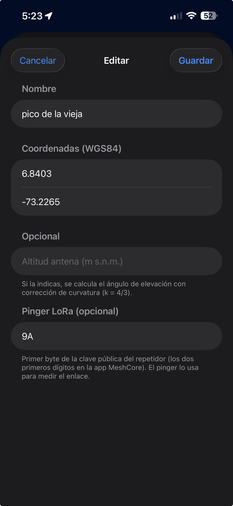 | **2. Escribe su prefijo hash.**<br>En el editor del repetidor, sección *Pinger LoRa*: los dos primeros dígitos de la clave pública del repetidor (los ves en la app MeshCore). Es opcional para apuntar, **obligatorio para medir**. |
| 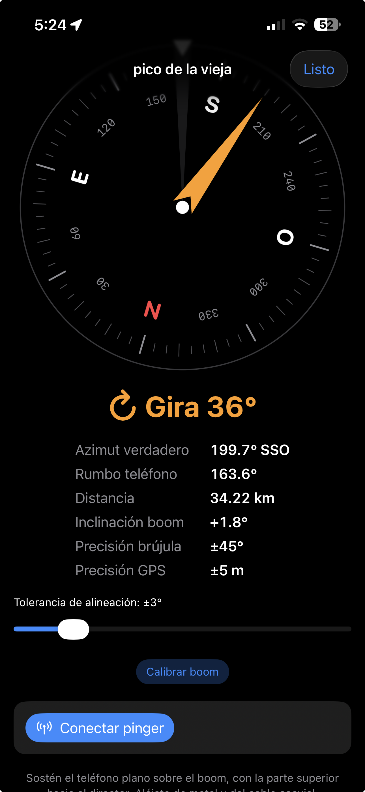 | **3. Apunta.**<br>Toca el panel inferior. Calibra la brújula (movimiento en ocho) si la precisión pasa de ±15°, y coloca el teléfono plano sobre el boom. La aguja naranja marca el repetidor; el dial se pone verde y vibra 3 s al alinear. |
| 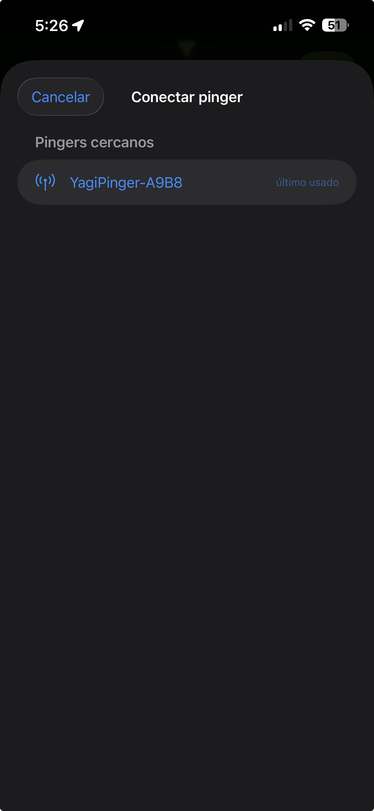 | **4. Conecta el pinger.**<br>Enciende el pinger y toca **Conectar pinger**. Elige `YagiPinger-XXXX` (el último usado se marca). Conecta en menos de 1 s con el pinger cerca. |
|  | **5. Mira el enlace en vivo.**<br>Con **En vivo** la app envía un ping cada 2 s y muestra SNR↑, SNR↓, RSSI, RTT, pérdida y una gráfica del SNR de subida. Gira la antena despacio: el SNR↑ sube al apuntar bien. |
| 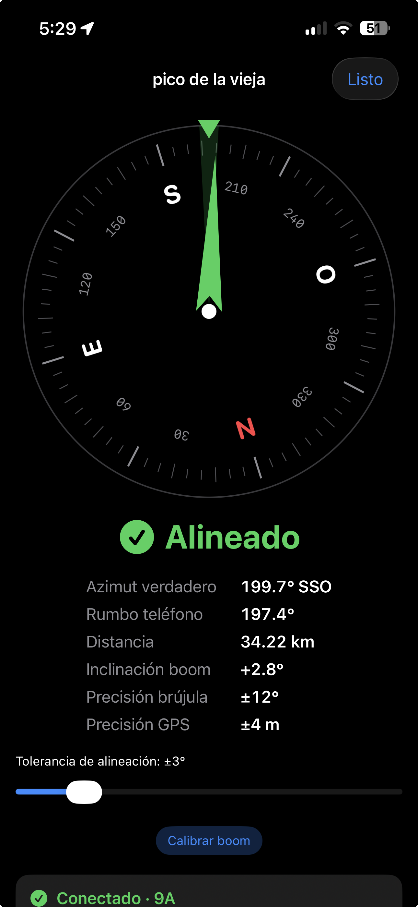 | **6. Ajuste fino por SNR.**<br>La brújula te lleva a ±3°; el último tramo se afina con el SNR↑ en vivo. |
| 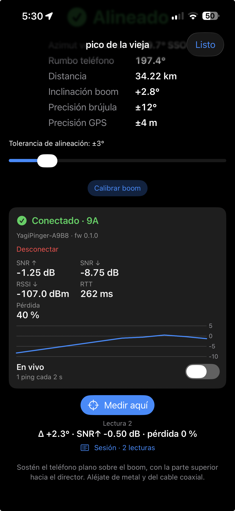 | **7. Mide aquí.**<br>Con la antena **quieta**, toca **Medir aquí**: se envían 5 pings (≈ 9 s) y cada uno guarda el rumbo del teléfono al transmitir y al recibir. |
| 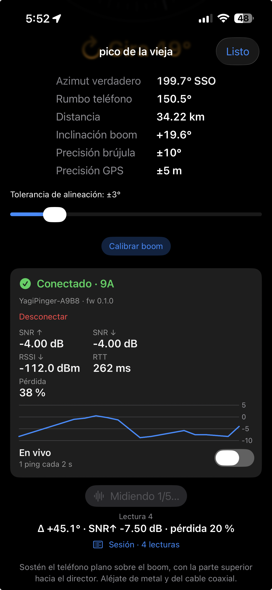 | **8. Lee el resultado.**<br>Aparece la **lectura**: Δ (rumbo − azimut), la mediana del SNR↑ y la pérdida. Si salió «Repetir», mantén el teléfono más quieto y vuelve a medir. |
| 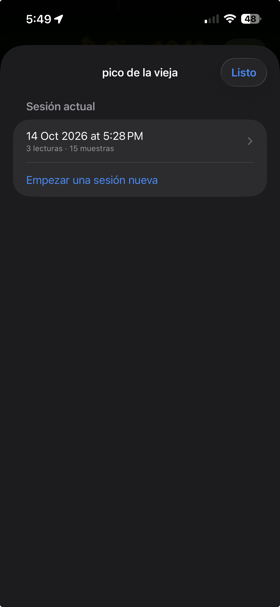 | **9. Compara orientaciones.**<br>Repite en 0°, ±15°, ±30°, ±60° y 180° respecto al azimut. *Sesión* lista todas las lecturas; abre *Anteriores* para ver días previos. |
| 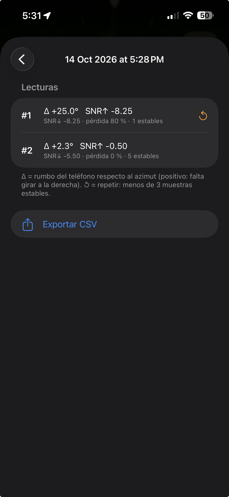 | **10. Exporta.**<br>**Exportar CSV** abre la hoja de compartir con una fila por muestra (se abre en Numbers o Excel). |

Al salir de la pantalla de apuntamiento la app se **desconecta** del pinger y deja de enviar pings; en segundo plano tampoco mide.

## 4. Resultados esperados

### Qué se mide

| Campo | Significado |
|---|---|
| **SNR ↑** | Cómo oye el repetidor al pinger (viene dentro del eco). Es la medida que importa para alinear. |
| **SNR ↓** | Cómo oye el pinger al repetidor. |
| **RSSI ↓** | Potencia recibida por el pinger (dBm). |
| **RTT** | Tiempo entre el fin del envío y el eco. Incluye la espera aleatoria del repetidor: no es una medida del enlace. |
| **Pérdida** | Pings sin eco sobre los respondidos. |
| **Δ** | Rumbo del teléfono menos azimut al repetidor. Positivo = falta girar a la derecha. |
| **Repetir** | Menos de 3 muestras estables: el teléfono se movió más de 2° entre el envío y el resultado (≈ 1.4 s), o el pinger retrasó el envío por su límite de tiempo en el aire. |

Referencia nominal: con SF10 el receptor LoRa demodula hasta unos **−15 dB de SNR**; el *margen* del enlace es el SNR medido menos ese valor.

### Valores medidos en banco

Pinger a menos de 1 m de la app, repetidor `4F` muy cercano, antena omni, 22 dBm (octubre de 2026):

| Medida | Resultado |
|---|---|
| Conexión BLE | ≈ 0.8 s |
| Tiempo por ping (comando → resultado) | ≈ 1.4 s |
| SNR ↑ / SNR ↓ | +9.25…+10.75 dB / +8…+9.25 dB |
| RSSI ↓ | −32…−39 dBm |
| RTT | 220…440 ms |
| Pérdida | 0 % (más de 20 pings seguidos, sin ninguno perdido) |

Con el repetidor tan cerca la señal es muy fuerte y casi no cambia con la orientación: **estos valores sirven para comprobar que todo funciona, no para comparar orientaciones.**

### Qué debes ver en campo

Estos comportamientos son el objetivo de diseño; se validan con la Yagi en un enlace largo:

- El **SNR↑ máximo** aparece cuando **Δ ≈ 0**.
- Al girar ±30° el SNR↑ baja (el haz de −3 dB de una Yagi de 3 elementos ronda los 60–70°).
- A **180°** el SNR↑ debe ser claramente menor, de unos **6 dB o más** con línea de vista.
- Repetir una lectura en la misma orientación debe dar medianas de SNR↑ dentro de ±1.5 dB.

Si no ves ese patrón, revisa la calibración del boom, el hash y la polarización de la antena.

### Qué contiene el CSV

`meshazimuth_<repetidor>_<fecha>.csv`: una fila por muestra con el repetidor y su hash, la lectura y la muestra, los instantes de envío y recepción, la ubicación, el azimut, los rumbos de envío y recepción, Δ, las marcas `unstable` e `invalid`, y los campos del ping (`seq`, `tag`, `status`, `rtt_ms`, `snr_up_db`, `snr_dn_db`, `rssi_dn_dbm`) más la potencia y el firmware. Formato completo: [session-csv.md](specs/003-ble-nus-yagiaim-link/contracts/session-csv.md).

## 5. Problemas frecuentes

| Síntoma | Qué hacer |
|---|---|
| No aparece `YagiPinger-…` | Enciende el pinger, acércalo (< 2 m) y comprueba que ningún otro teléfono esté conectado (admite un solo central). |
| «Bluetooth apagado» o «sin permiso» | Usa el botón **Abrir Ajustes** y activa Bluetooth / el permiso de MeshAzimuth. |
| «Medir aquí» está desactivado | Falta el prefijo hash del repetidor, no hay brújula o el pinger no está conectado. |
| «Calibra la brújula» | La precisión es peor que ±15° o no está calibrada: mueve el teléfono en forma de ocho, lejos de metal. |
| Todos los pings dan *sin respuesta* | Hash equivocado, repetidor fuera de alcance, antena desconectada o radio con otro preset. Más pistas en [FLASHING.md](https://github.com/120m4n/MeshCore-HJ7RMN/blob/feature/i2c-actuator-public-channel/examples/trace_pinger/FLASHING.md). |
| Aviso «el pinger retrasó un envío» | Superaste su límite de tiempo en el aire; la muestra queda invalidada. Usa «En vivo» a 2 s (ya es el valor por defecto). |
| Quiero probar sin hardware | *Acerca de → Depuración → Pinger simulado*: genera mediciones según tu rumbo y el azimut. |

## Funciones

- **Mapa:** satélite de Apple o teselas OSM con caché pasiva (se gestiona en *Acerca de*). Se guardan varios repetidores con nombre, altitud y prefijo hash; búsqueda, orden por cercanía, importar y exportar JSON.
- **Azimut y elevación:** azimut verdadero por círculo máximo; elevación con corrección de curvatura k = 4/3 si das la altitud.
- **Brújula:** `CLHeading.trueHeading` ya corrige la declinación magnética (≈ −6° en Colombia); sin GPS cae a norte magnético y lo avisa. Suavizado exponencial sobre sin/cos para evitar el salto 359°→0°.
- **Alineación con histéresis:** entra a ±tolerancia (1–15°, por defecto ±3°) y sale a ±(tolerancia + 2°); vibra 3 s al alinear.
- **Calibración del boom** y **inclinación** (Core Motion) con «Sube/Baja X°».
- **Pinger:** conexión BLE, enlace en vivo, lecturas atadas al rumbo, sesiones persistentes y exportación CSV.

## Persistencia entre reinicios

- Se conservan: repetidores y selección, tolerancia, estilo del mapa, la última región vista y la última ubicación (al abrir, azimut y distancia aparecen al instante con la etiqueta «ubicación anterior»).
- Las **sesiones** del pinger se guardan como JSON en el teléfono (`Application Support/Sessions`).
- Sin red se muestra un aviso. El mapa estándar guarda en caché hasta 500 MB de lo que has visto: recorre la zona con red antes de ir a campo. El satélite requiere conexión.

## Pruebas y desarrollo

- `⌘U` en Xcode (o `xcodebuild test -scheme MeshAzimuth -destination 'platform=iOS Simulator,name=<simulador>'`): geodesia, parser del protocolo del pinger, reglas de las lecturas y exportación CSV.
- El parser se valida con los mismos fixtures que el firmware: `tools/sync_fixtures.sh --check` comprueba que la copia local coincide con la del repo MeshCore.
- Las especificaciones de las tres fases están en [`specs/`](specs/): 001 firmware del pinger, 002 verificación contra el parser upstream, 003 enlace BLE y lecturas.

## Estructura

| Archivo | Rol |
|---|---|
| `MeshAzimuthApp.swift` | Punto de entrada e inyección de dependencias |
| `ContentView.swift` | Mapa y panel inferior |
| `AimView.swift` / `AimInfo.swift` | Pantalla de apuntamiento y cálculo de azimut/distancia/elevación |
| `PingerSection.swift` / `LinkCard.swift` / `PingerPicker.swift` | Conexión, enlace en vivo y «Medir aquí» |
| `SessionView.swift` | Lecturas, historial y exportación CSV |
| `Link/LineCodec.swift` | Parser del protocolo de líneas del pinger y reensamblado |
| `Link/LineTransport.swift` | Protocolo de transporte y estados del enlace |
| `Link/BLELineTransport.swift` | Bluetooth (Nordic UART) con CoreBluetooth |
| `Link/PingerLink.swift` | Handshake, ping, modo en vivo y reconexión |
| `Link/SimulatedPinger.swift` | Pinger simulado para depuración |
| `Session/SessionModels.swift` | Muestras, lecturas y reglas (inestable, inválida, medianas, pérdida) |
| `Session/SessionRecorder.swift` | Medición con rumbo al enviar y al recibir |
| `Session/SessionStore.swift` / `SessionCSV.swift` | Persistencia JSON y exportación CSV |
| `RepeaterViews.swift` / `RepeaterStore.swift` | Lista, editor (con prefijo hash) y persistencia de repetidores |
| `CompassView.swift` / `Haptics.swift` | Brújula con histéresis y vibración sostenida |
| `LocationManager.swift` / `MotionManager.swift` | GPS, rumbo suavizado y calibración; inclinación del boom |
| `MapView.swift` | MKMapView con teselas OSM en caché, anotaciones y toques |
| `NetworkMonitor.swift` / `PermissionBanner.swift` | Avisos sin red / sin permiso de ubicación |
| `AboutView.swift` / `OnboardingView.swift` | Acerca de (versión, caché, depuración) y guía de uso |
| `Geo.swift` | Azimut, haversine, elevación, delta con signo, mediana y media circular |
| `Theme.swift` | Paleta de colores |
| `PrivacyInfo.xcprivacy` | Manifiesto de privacidad de Apple |
| `tools/sync_fixtures.sh` | Sincroniza los fixtures de líneas con el repo MeshCore |
| `design/` | Logo original y capturas de referencia |

## Privacidad

Ver [PRIVACY.md](PRIVACY.md).
