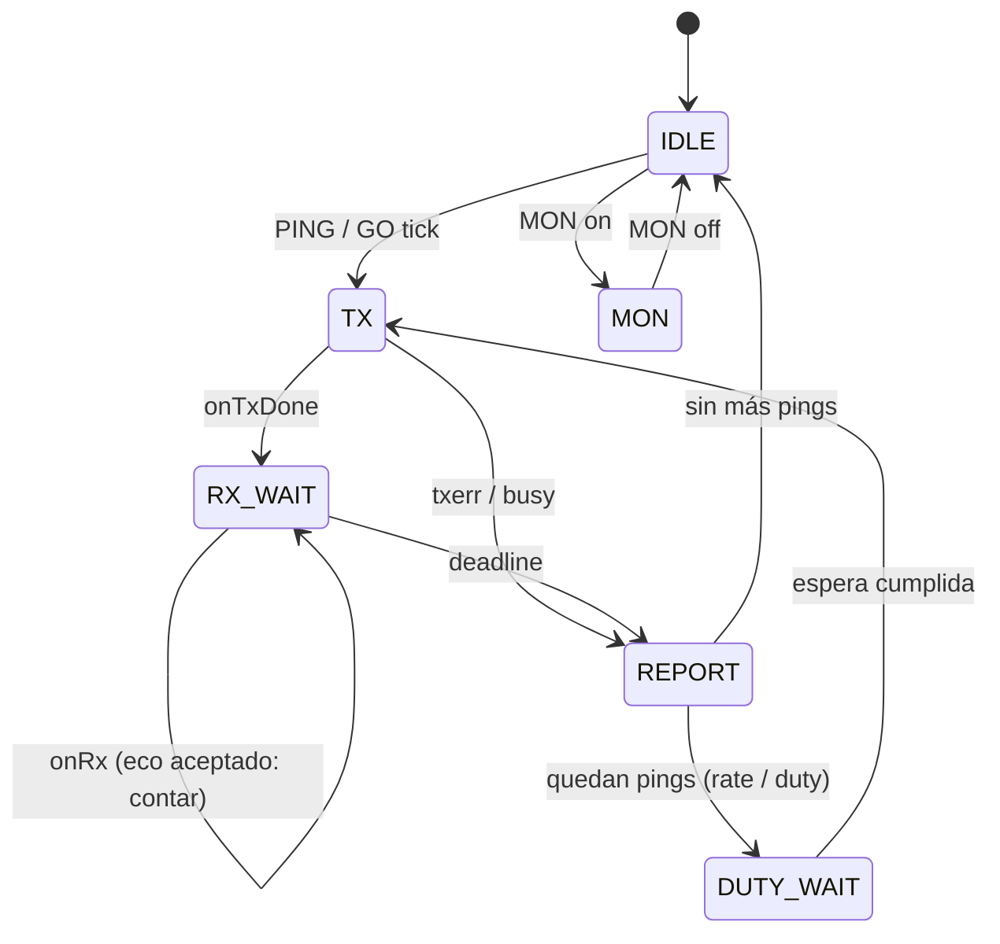

# Data Model: 001 Pinger TRACE

Todos los tipos viven en `firmware/pinger/lib/tracecore/include/tracecore/`, namespace `tracecore`, C++17 sin dependencias de Arduino.

## RadioConfig

| Campo | Tipo | Regla |
|---|---|---|
| freq_mhz | float | 902.0–928.0 |
| bw_khz | float | ∈ {7.8, 10.4, 15.6, 20.8, 31.25, 41.7, 62.5, 125, 250, 500} |
| sf | uint8 | 5–12 |
| cr | uint8 | 5–8 |
| txp_dbm | int8 | −9–22 (sin tope adicional) |
| `preamble()` | uint16 | derivado: `sf <= 8 ? 32 : 16` |
| `sync_word` | const | `0x12` |

## PingerConfig

| Campo | Tipo | Regla |
|---|---|---|
| radio | RadioConfig | — |
| hash | optional<uint8> | requerido para PING/GO |
| rate_ms | uint32 | 1000–60000 |
| timeout_ms | optional<uint32> | vacío = auto; si no, 200–10000 |
| raw | bool | — |

Serialización persistente: `magic 'YPNG' | version u8 = 1 | struct | crc16-ccitt`.

## TraceRequest (pendiente)

| Campo | Tipo |
|---|---|
| seq | uint32 |
| tag | uint32 |
| hash | uint8 |
| t_tx_done_ms | uint32 (marca de fin de TX; el RTT se mide desde aquí) |
| deadline_ms | uint32 |
| echoes | uint8 |
| first | optional<Echo> |

## Echo

| Campo | Tipo | Origen |
|---|---|---|
| snr_up_q | int8 | `path[0]`, en cuartos de dB |
| snr_dn | float | radio |
| rssi_dn | float | radio |
| t_rx_ms | uint32 | radio |

## PingResult → línea `P,`

`seq, tag, status{Ok,Timeout,Busy,TxErr}, rtt_ms?, snr_up?, snr_dn?, rssi_dn?, n_resp`

## BurstSummary → línea `S,`

`n, ok, loss_pct = round(100·timeouts/(ok+timeouts)), median(snr_up), median(snr_dn), median(rssi_dn), busy` (`busy` y `txerr` no cuentan como pérdida)

## RawFrame → línea `R,`

`t_ms, rssi, snr, bytes[≤255]`

## Estado del Pinger

Notas:
- `RX_WAIT` siempre espera hasta el *deadline* (no termina en el primer eco) para poder contar colisiones (FR-015). Así el RTT reportado es el del primer eco, mientras que la latencia del comando es `ToA + timeout`. Con SF10/BW250 eso da 177 + 1207 ≈ 1.38 s, dentro de SC-002 (≤ 1.6 s). El siguiente ping de una ráfaga empieza en `max(inicio + rate, reporte)`.
- Duty cycle: un acumulador de tiempo de TX en ventana deslizante de 60 s (anillo de 64 entradas `{t_start, dur}`).
